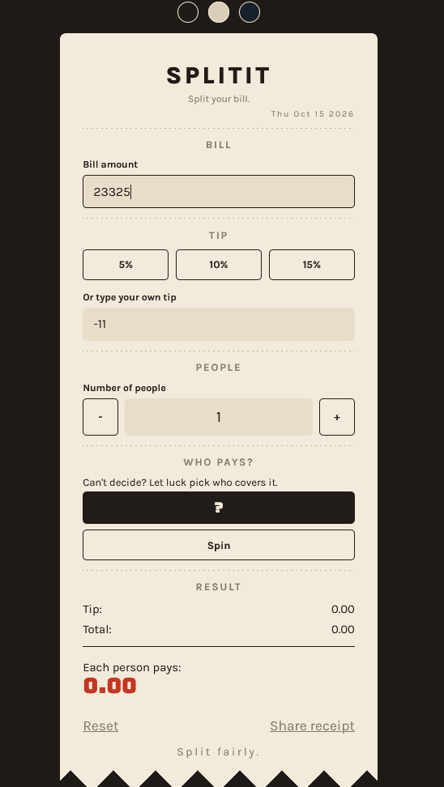
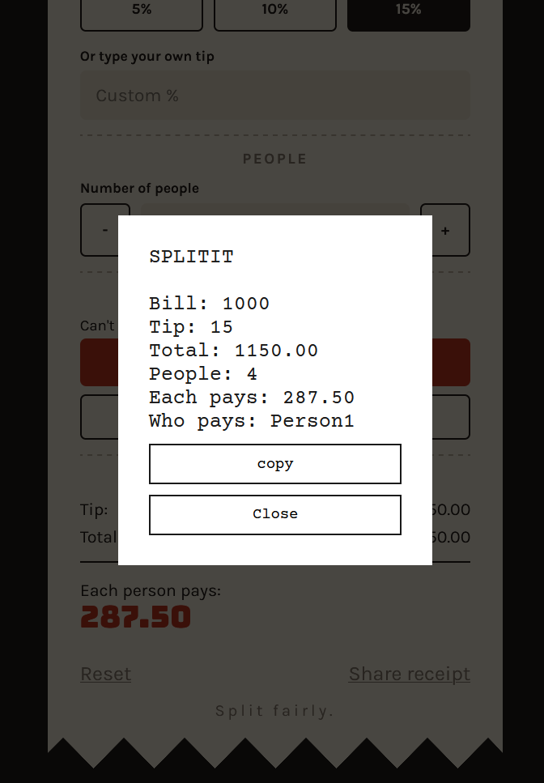

# SplitIt
A simple web app that splits any bill between any number of people. Enter the amount, pick a tip, set how many people are sharing, and see what each person pays.

[Check it out](https://nikhilkshub.github.io/SplitIt/)

# Screenshot 

## Features
- Bill amount, tip presets (5%, 10%, 15%) or a custom tip, and a people counter
- "Who pays?" a fun feature to randomly pick a person to pay the whole amount 
- Share receipt feature to share your splits
- Three themes: Night, Day and Blueink
- Reset button that resets every field to use it again 

## Built with
HTML, CSS and JavaScript.

## How to run
1. Download or clone this repository.
2. Open `index.html` in your browser.

## Credits
- Fonts: Bungee, Karla and Courier Prime from Google Fonts 
- Zig-zag design on bottom of card is taken from css-shape website

## AI usage
- I used Claude and google to understand concepts and codes mostly in JS because I dont know much in that language, it helped me understand things and helped me in codes like:-  
- fixing selected button issue in Tip section, 
- it also pointed out few things like people counter cannot be negative or 0 because initially my code allowed this and split bill calculation divides total money by number of people and if it was 0 the answer can come in infinity,
- a little clarity in the reset button i was able to write it myself but there were some values like tipAmount , totalAmount , perPerson not getting 0 it was because those are span elements and i was trying to use .value to make them 0 ,solved it using textcontent
-  it also pointed out the negative input in bill amount and custom tip that are not good, to solve it i just simply added in the if(people<1 || bill<0 || tipPercent<0) to not calculate and show 0
- and understand concepts like share feature and who pays roulette 

## The project does not contain any AI generated code or anything related to it, I just took help of it to understand things. 
